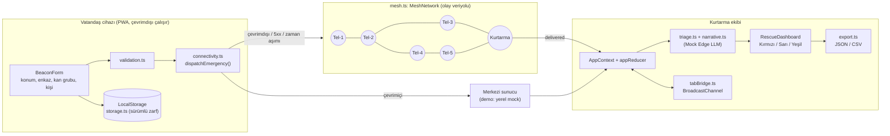
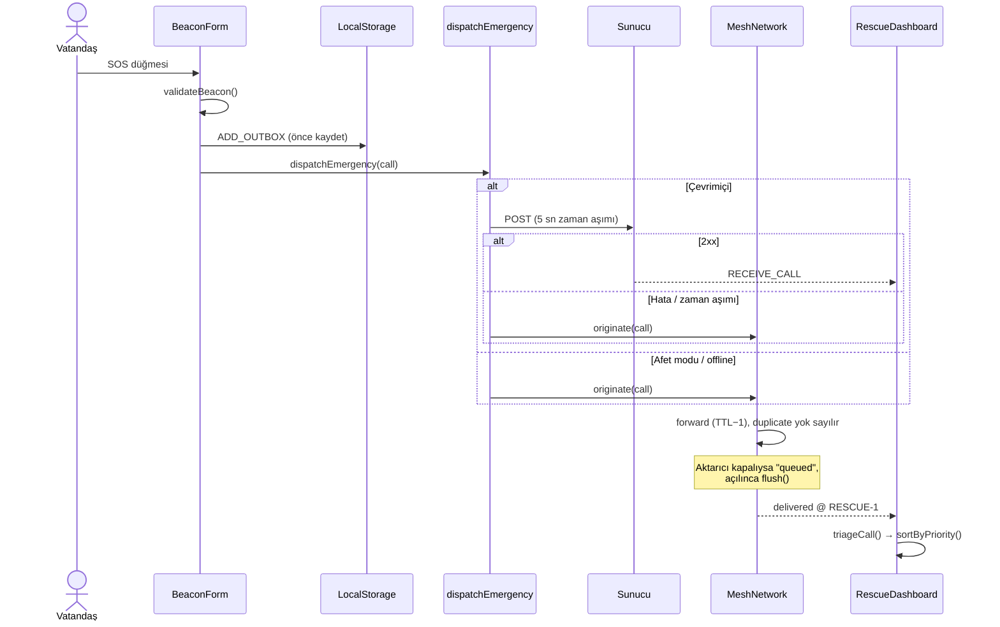

# AfetMesh AI (ResQ-Mesh)

> GSM ve internet kesildiğinde telefonlar arası aktarımla çalışan, cihaz üstü önceliklendirme (triage) destekli deprem iletişimi ve arama-kurtarma paneli.

**Ders:** Yazılım Gerçekleme ve Test, Ödev 3
**Teknoloji:** Vite 5 · React 18 · TypeScript 5 (strict) · TailwindCSS 3 · Vitest 2 · React Testing Library · PWA (service worker)

| Ölçüt | Sonuç (7 Kasım 2026, yerel çalıştırma) |
|---|---|
| Test dosyası / test | **11 / 147, tamamı geçti** |
| Satır kapsamı | **%100** |
| Dal (branch) kapsamı | **%98.71** |
| Fonksiyon kapsamı | **%100** |
| Kapsam eşiği (CI'da başarısız sayılır) | %85 (satır, dal, fonksiyon, ifade) |
| `tsc --noEmit` | hatasız |
| `vite build` | başarılı, JS 181 kB (gzip 58.7 kB) |

---

## 1. Executive Summary

### Problem
Büyük depremlerden sonraki ilk saatlerde baz istasyonları enerji kaybı, fiziksel hasar ve aşırı yük nedeniyle çökebilir. Enkaz altındaki ya da yakınındaki kişinin elinde çalışan bir telefon olsa bile çağrısı kurtarma ekibine ulaşamayabilir. Ulaşan çağrılar da sesli ve dağınık geldiği için hangisine önce gidileceğine karar vermek zorlaşır.

### Çözüm
AfetMesh AI üç işi tek uygulamada birleştirir:

1. **Önce cihaza kaydet.** Çağrı LocalStorage'a yazılır. Uygulama PWA olarak önbelleğe alındığı için ağ yokken de açılır.
2. **Ağ yoksa mesh'e bırak.** İnternet yoksa, sunucu hata verirse ya da 5 saniye içinde yanıt gelmezse çağrı otomatik olarak telefondan telefona aktarılır (TTL, tekrar engelleme, sakla-ilet).
3. **Kurtarma ekibine sıralı liste ver.** Gelen çağrılar enkaz durumu, yaralı sayısı, serbest metindeki kritik belirtiler, kırılgan gruplar ve bekleme süresine göre 0-100 puanlanır ve Kırmızı/Sarı/Yeşil olarak sıralanır. Liste JSON/CSV olarak dışa aktarılır.

### Y Combinator RFS bağlantısı

[ycombinator.com/rfs](https://www.ycombinator.com/rfs) sayfası 7 Kasım 2026'da kontrol edildi (Spring 2026, Summer 2026, Fall 2026 ve Winter 2027 listeleri). AfetMesh AI ile doğrudan bağ kurulabilen başlıklar şunlar:

| YC RFS başlığı | Dönem | AfetMesh AI ile bağı |
|---|---|---|
| **AI for the Air-Gapped Economy** (Brad Flora) | Winter 2027 | YC, internete hiç bağlanamayan ortamlarda çalışan yapay zekâ istiyor. Deprem sonrası telefon da fiilen böyle bir ortamdadır. Önceliklendirme bulut API'sine gitmeden, tamamen cihazda çalışır. |
| **AI for Government** (Tom Blomfield) | Spring 2026 | Afet koordinasyonu AFAD ve valilik gibi kamu kurumlarının işidir. Panel, dağınık gelen çağrıları elle ayıklamak yerine yapılandırılmış ve sıralanmış bir listeye çevirir. |
| **AI for City Hall** (Gustaf Alströmer) | Winter 2027 | Belediyeler arama-kurtarma ve enkaz kaldırmada ilk müdahale eden birimlerdendir. JSON/CSV dışa aktarım, mevcut kurum sistemlerine veri aktarmanın en basit yoludur. |

> **Not:** Bu tablo yalnızca listede gerçekten bulunan başlıkları içerir. Kontrol edilen listelerde "afet", "deprem" ya da "mesh ağ" konulu bir RFS başlığı yoktur. AfetMesh AI'ın bu başlıklarla bağı yorumdur, YC'nin bu ürün için yaptığı bir çağrı değildir.

### Ürün konumlandırma eksenleri

Aşağıdaki üç tema sektör eğilimi olarak kullanılmıştır. **YC RFS başlığı değildir**, kontrol edilen listelerde bu adlarla bir başlık bulunmaz.

- **Decentralized Physical Infrastructure (DePIN):** Ağın düğümleri, vatandaşların zaten cebinde taşıdığı telefonlardır. Baz istasyonu çöktüğünde iletişim altyapısı, sahadaki cihazların kendisinden oluşur. DePIN projelerinin çoğundan farklı olarak AfetMesh AI'da token ya da ödül katmanı yoktur. Katılımın gerekçesi teşvik değil, karşılıklı yardımdır.
- **Edge AI & Offline-First Systems:** Veri önce cihaza yazılır, uygulama service worker ile ağsız açılır, önceliklendirme yerelde hesaplanır. Bulut isteğe bağlı bir hızlandırıcıdır, bağımlılık değildir. Bu ilke, yukarıdaki "Air-Gapped Economy" başlığıyla doğrudan örtüşür.
- **Resilient Critical Infrastructure:** Sistem kademeli bozulacak şekilde tasarlandı: internet → sunucu hatası/zaman aşımı → mesh → sakla-ilet. Hiçbir adımda çağrı düşürülmez. Bu davranış iddia olarak bırakılmadı, `connectivity.test.ts` ve `mesh.test.ts` içindeki kesinti senaryolarıyla test edildi (bkz. Bölüm 3.3).

---

## 2. System Architecture

### 2.1 Bileşen diyagramı



### 2.2 Ağ kesintisinde çağrının yolu



### 2.3 Klasör yapısı

```
afetmesh-ai/
├─ public/            manifest.webmanifest, sw.js (çevrimdışı kabuk), icon.svg
├─ src/
│  ├─ lib/            saf TypeScript çekirdeği, React'e bağımlı değil
│  │  ├─ triage.ts        kural tabanlı önceliklendirme (0-100, RED/YELLOW/GREEN)
│  │  ├─ narrative.ts     Mock Edge LLM: TR/EN serbest metinden risk işaretleri
│  │  ├─ mesh.ts          MeshNetwork: flooding + TTL + tekrar engelleme + sakla-ilet
│  │  ├─ connectivity.ts  internet → mesh yedekli gönderim, zaman aşımı
│  │  ├─ storage.ts       sürümlü, bozuk veriye dayanıklı LocalStorage ayrıştırıcı
│  │  ├─ validation.ts    form doğrulama (virgüllü ondalık, aralıklar)
│  │  ├─ export.ts        AFAD/AKUT'a uygun önerilen JSON şeması + CSV (BOM)
│  │  ├─ tabBridge.ts     sekmeler arası BroadcastChannel senkronu
│  │  ├─ i18n.ts          Türkçe / İngilizce
│  │  └─ call.ts          id ve çağrı üretimi
│  ├─ state/          appReducer (saf) + AppContext (bağımlılık enjeksiyonu)
│  ├─ components/     BeaconForm, MeshSimulator, RescueDashboard, ExportPanel
│  ├─ __tests__/      11 test dosyası
│  └─ test/           setup ve test veri fabrikaları
└─ vite.config.ts     Vitest + kapsam eşikleri
```

**Tasarım kararı:** Tüm iş mantığı `lib/` altında saf fonksiyonlar ve sınıflar olarak tutuldu. `AppProvider` mesh, depolama, sunucu ve BroadcastChannel'ı prop olarak alır. Böylece testler gerçek tarayıcı API'lerine dokunmadan her bağımlılığı sahtesiyle değiştirebilir.

### 2.4 Önceliklendirme kuralı

| Etken | Puan |
|---|---|
| Enkaz altında / kısmen sıkışmış | +40 / +25 |
| Yaralı var | +10 + 3 × min(yaralı, 5) |
| Kritik belirti (nefes alamıyor, bilinçsiz, kanama, ezilme…) | +20 × min(terim, 2) |
| Tıbbi bağımlılık (diyaliz, insülin, oksijen, astım, kalp) | +10 |
| Hamilelik | +8 |
| Çocuk / yaşlı | +8 / +8 |
| Sesli iletişim kuramıyor | +10 |
| 3 ve üzeri kişi | +2 × min(kişi, 10) |
| Bekleme süresi (≥ 1 saat) | 0-15, 72 saatte doyar |

Skor 0-100 aralığına kırpılır. **≥ 60 Kırmızı, ≥ 30 Sarı, diğerleri Yeşil.** Ağırlıklar bu ödev için seçilmiş varsayımlardır. Klinik olarak doğrulanmamıştır (bkz. Sınırlılıklar).

---

## 3. Test Results & Coverage Metrics

Komut: `npm run coverage` (Vitest 2.1.9, v8 kapsam sağlayıcısı, jsdom).

### 3.1 Test süiti

| Dosya | Tür | Test | Neyi kanıtlıyor |
|---|---|---:|---|
| `triage.test.ts` | Unit | 24 | Eşik sınırları, her ağırlık, tavanlar, 100'e kırpma, geçersiz/gelecek tarih, sıralama (kurtarılan en sonda, eşitlikte eski önce) |
| `narrative.test.ts` | Unit | 8 | Türkçe İ/ı küçültme, iç içe terimin tek sayılması, Mock Edge LLM gecikmesi (sahte zamanlayıcı) |
| `validation.test.ts` | Unit | 22 | 12 hatalı girdi senaryosu (tablo testi), virgüllü ondalık, metin kırpma, id üretimi |
| `storage.test.ts` | Unit | 28 | **Offline storage parser:** bozuk JSON, eski dizi biçimi, gelecek sürüm, kısmen bozuk kayıt, tekrarlar, kota hatası, gizli mod |
| `mesh.test.ts` | Unit | 12 | Çok atlamalı aktarım, tekrar engelleme, TTL, sakla-ilet, yeni bağlantıda akış, hata durumları |
| `connectivity.test.ts` | Unit + **kesinti simülasyonu** | 9 | Offline, 5xx, zaman aşımı → mesh. Gerçek mesh üzerinde uçtan uca kesinti ve toparlanma |
| `export.test.ts` | Unit | 6 | JSON şeması, CSV kaçış karakterleri, BOM, indirme (Blob/URL sahtesi) |
| `tabBridge-i18n-reducer.test.ts` | Unit | 12 | Sekme köprüsü, sözlük eşliği (TR/EN aynı anahtarlar), reducer |
| `App.integration.test.tsx` | **Integration** | 18 | SOS → state → mesh → panel. Sunucu hatası/zaman aşımı yedeği, `offline` olayı, dil, konum izni, sekmeler arası çağrı |
| `RescueDashboard.test.tsx` | Integration | 5 | Sıralama, filtre, kurtarıldı işaretleme, depoya yazma, JSON/CSV indirme |
| `regression.strictmode.test.tsx` | **Regresyon** | 3 | Tarayıcıda bulunan hatanın (aşağıda) tekrar etmemesi |
| **Toplam** | | **147** | |

### 3.2 Kapsam raporu

```
File               | % Stmts | % Branch | % Funcs | % Lines
-------------------|---------|----------|---------|--------
All files          |     100 |    98.71 |     100 |     100
 App.tsx           |     100 |      100 |     100 |     100
 components/       |     100 |    97.65 |     100 |     100
 lib/              |     100 |    99.61 |     100 |     100
 state/            |     100 |    96.49 |     100 |     100
```

Kapsam dışı bırakılanlar ve nedeni: `main.tsx` (yalnızca kök render), `pwa.ts` (yalnızca üretimde service worker kaydı), `types.ts` (yalnızca tipler), test yardımcıları. Kalan %1.3 dal; `?? ''` gibi savunmacı varsayılanlardır.

### 3.3 Ağ kesintisi senaryoları

| Senaryo | Nerede | Beklenen | Sonuç |
|---|---|---|---|
| GSM/internet tamamen kesik | `connectivity`, `App.integration` | Sunucu çağrılmaz, mesh'e gider | Geçti |
| Sunucu 502/503 | `connectivity`, `App.integration` | "Sunucuya ulaşılamadı" + mesh | Geçti |
| Baz istasyonu yanıt vermiyor | `connectivity` (sahte zamanlayıcı), `App.integration` | 5 sn sonra mesh | Geçti |
| İki aktarıcı telefon kapalı | `mesh`, `App.integration` | Çağrı bekletilir, panel boş | Geçti |
| Aktarıcı yeniden açılıyor | `mesh`, `App.integration` | Bekleyen çağrı panele düşer | Geçti |
| Kaynak telefonun kendisi kapalı | `mesh` | Telefon açılınca yayılır | Geçti |
| Tarayıcı `offline` olayı | `App.integration` | Rozet "mesh modu" olur | Geçti |
| LocalStorage engelli / kota dolu | `storage` | Uygulama düşmez | Geçti |

### 3.4 Testlerin bulamadığı, tarayıcıda bulunan hata

Birim ve entegrasyon testleri ilk turda tamamen yeşildi. Uygulama gerçek tarayıcıda açılınca SOS düğmesi "Gönderiliyor…" durumunda **takılı kaldı**. Konsolda `InvalidStateError: Channel is closed` vardı.

- **Kök neden:** React `StrictMode` geliştirme modunda efektleri kur-sök-kur sırasıyla çalıştırır. BroadcastChannel `useMemo` ile bir kez oluşturuluyor, ilk temizlikte kapanıyor ve bir daha açılmıyordu. Kapalı kanala yayın yapılınca hata mesh dinleyicisinden yukarı fırladı ve aktarım zincirini kırdı.
- **Testler neden kaçırdı:** Testler StrictMode kullanmıyordu ve köprü `null` olarak enjekte ediliyordu.
- **Düzeltme (3 katman):** köprü efekt içinde kuruldu. `publish` hatayı yutup `false` dönüyor. `MeshNetwork.emit` bir dinleyicinin hatasını izole ediyor, böylece arayüzdeki bir hata başka telefonlara aktarımı durdurmuyor. `BeaconForm` gönderim durumunu `finally` ile sıfırlıyor.
- **Regresyon testi:** `regression.strictmode.test.tsx`, StrictMode altında, kapandıktan sonra gerçek tarayıcı gibi hata fırlatan bir kanal sahtesiyle uçtan uca akışı doğruluyor.

Bu, kapsam yüzdesinin tek başına yeterli olmadığını gösteren somut bir örnek: kod %100 satır kapsamındayken çalışma ortamı farkı (StrictMode) bir hatayı gizliyordu.

---

## 4. Innovation & Regionalization Highlights

**Teknik**
- **Önce kaydet, sonra gönder.** Çağrı ağ durumundan bağımsız olarak cihazda kalıcıdır. Sayfa yenilense de kaybolmaz (tarayıcıda doğrulandı).
- **Otomatik ve kademeli yedek.** Kullanıcı "internet var mı" diye düşünmez. Offline, 5xx ve zaman aşımı aynı yoldan mesh'e düşer ve nedeni kullanıcıya söylenir.
- **Sakla-ilet mesh.** Aktarıcı kapalıysa çağrı düşürülmez, bekletilir. TTL sonsuz yayılmayı, mesaj kimliği döngüleri önler.
- **Cihaz üstü önceliklendirme.** Sunucuya ihtiyaç duymadan, açıklanabilir gerekçelerle ("Enkaz altında", "Kritik belirti"…) çalışır. `EdgeTriageModel` arayüzü gerçek bir küçük dil modelinin takılabileceği noktadır.
- **Test edilebilir mimari.** Bağımlılık enjeksiyonu sayesinde ağ, depolama, zaman ve tarayıcı API'leri testte tamamen kontrol edilir.

**Yerelleştirme (Türkiye)**
- Türkçe varsayılan, İngilizce seçenekli arayüz. Tercih cihazda saklanır.
- Türkçeye özgü büyük/küçük harf (`İ→i`, `I→ı`) doğru işlenir. "BİLİNÇSİZ" de "bilinçsiz" de yakalanır.
- Kan grubu Türkiye'deki yazımla `0+ / 0-` biçiminde. Yaygın kronik bağımlılıklar (diyaliz, insülin, oksijen) önceliği yükseltir.
- Ondalık virgül (`37,5753`) kabul edilir.
- CSV dosyası UTF-8 BOM ile üretilir, Türkçe karakterler Excel'de bozulmaz.
- Dışa aktarım AFAD/AKUT ekiplerinin ihtiyaç duyacağı alanları (konum, enkaz, kan grubu, kişi/yaralı, kırılgan grup, aktarım yolu, öncelik gerekçesi) içerir.

### Sınırlılıklar (bilerek yapılmayanlar)
- **Gerçek radyo/WebRTC taşıyıcısı yok.** Mesh, bellek içi bir olay veriyolu simülasyonudur. Sekmeler arası senkron BroadcastChannel ile yapılır. Gerçek cihazlar arası aktarım için BLE/Wi-Fi Direct/WebRTC taşıyıcısı `MeshNetwork`'e bağlanmalıdır. WebRTC de ilk bağlantı kurulumu (sinyalleşme) için genelde bir sunucuya ihtiyaç duyar.
- **"Edge LLM" bir sahtedir (mock).** Sözlük tabanlı, deterministik bir çıkarımcıdır. Gerçek bir dil modeli değildir.
- **Önceliklendirme ağırlıkları klinik olarak doğrulanmamıştır.** Karar destek önerisidir, tıbbi triyajın (ör. START) yerine geçmez. Son karar kurtarma ekibindedir.
- **AFAD/AKUT dışa aktarım şeması resmî değildir.** Bu projenin önerdiği alan şemasıdır. Entegrasyon öncesi kurumla alan eşlemesi yapılmalıdır.
- **Kimlik doğrulama, şifreleme ve sahte çağrı koruması yok.** Gerçek kullanımda mesaj imzalama ve kötüye kullanım önleme gerekir.
- **Merkezi sunucu yok.** "Çevrimiçi" yol, demoda çağrıyı 120 ms gecikmeyle doğrudan panele ileten yerel bir sahte sunucudur.

---

## 5. Kurulum ve Canlı Çalıştırma

Gereksinim: Node.js 18+ (Node 24.22 ve npm 11.19 ile denendi).

```bash
cd afetmesh-ai
```

```bash
npm install
```

```bash
npm run dev
```

Tarayıcıda `http://localhost:5173` açılır.

```bash
npm run coverage
```

Kapsam raporu terminale yazılır, HTML raporu `coverage/index.html` altına üretilir.

```bash
npm run build && npm run preview
```

Üretim derlemesi service worker'ı kaydeder. Sayfayı bir kez açtıktan sonra DevTools → Network → **Offline** seçip yenileyin: uygulama çevrimdışı açılmaya devam eder.

### Sunum için 2 dakikalık demo akışı
1. **Acil Çağrı** sekmesi: "Afet modu: AÇIK" ve "Bağlantı yok: mesh modu" rozetini gösterin.
2. **Mesh Ağı** sekmesi: `Tel-3 (sokak)` ve `Tel-5 (toplanma alanı)` düğümlerini **Kapalı** yapın.
3. **Acil Çağrı**: Enlem `37.5753`, Boylam `36.9228`, metin "babam bilinçsiz, diyaliz hastası" girip SOS'a basın. "Ön değerlendirme: KIRMIZI" çıkar.
4. **Kurtarma Paneli** boştur, çünkü çağrı yolda bekliyor. **Mesh Ağı**'nda "Bekleyen aktarım: 2" ve günlükte "bekletiliyor" görünür.
5. `Tel-3`'ü yeniden **Açık** yapın. Günlükte "Kurtarma Ekibi çağrıyı aldı" görünür. Panelde kırmızı kart ve "3 atlama" çıkar.
6. **JSON indir / CSV indir** ile dışa aktarın.
7. "Afet modu"nu kapatıp yeni bir çağrı gönderin: "internet üzerinden iletildi" ve "1 atlama" görünür.
8. Uygulamayı ikinci bir sekmede açın: kurtarma paneline düşen çağrılar sekmeler arasında senkronlanır.

### Komut özeti

| Komut | Ne yapar |
|---|---|
| `npm run dev` | Geliştirme sunucusu |
| `npm test` | Tüm testler (tek seferlik) |
| `npm run test:watch` | İzleme modunda testler |
| `npm run coverage` | Testler + kapsam raporu + %85 eşik denetimi |
| `npm run typecheck` | TypeScript tip denetimi |
| `npm run build` | Tip denetimi + üretim derlemesi |
